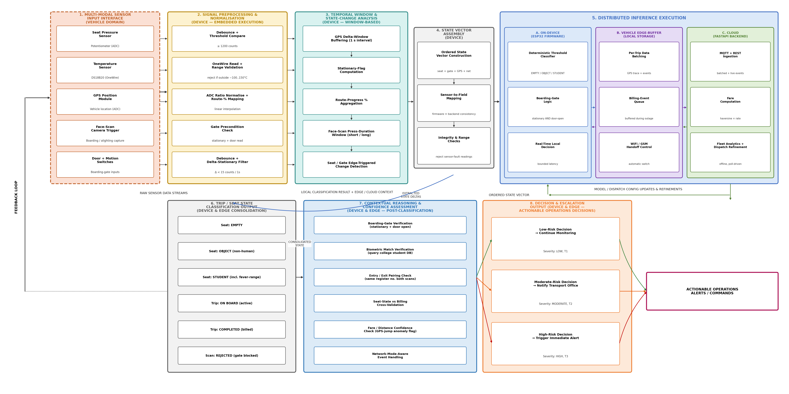

# VIT Smart Shuttle Management System

> **IoT-enabled smart campus shuttle system** — real-time seat occupancy classification, GPS tracking, biometric boarding verification, automated distance-based billing, WiFi/GSM network fallback, and demand-poll-driven dispatch.  
> Built for **VIT Vellore** as part of an embedded IoT + full-stack engineering project.

---

## Project Description

The VIT Smart Shuttle System replaces manual shuttle coordination with an integrated IoT pipeline. An ESP32 microcontroller on each shuttle collects data from:

- **Pressure + temperature sensors** (FSR + DS18B20) mounted under each seat to classify occupancy as `AVAILABLE`, `OCCUPIED`, or `BAG_DETECTED`
- **GPS module** (simulated via potentiometer in Wokwi) for real-time route tracking and stop-based progress
- **Biometric face-scan button** for passenger entry verification
- **WiFi/GSM toggle** for network fallback simulation

Sensor events are published over **MQTT (HiveMQ)** to a **FastAPI + SQLite** backend, which classifies seats, updates passenger counts, records trips, and calculates GPS-distance-based fares (`max(₹2, distance_km × ₹5)`). A **React + TypeScript** management dashboard consumes the REST API and displays all data in real time. A **Python Tkinter GUI** cross-validates sensor readings independently.

---

## Architecture

```
ESP32 (Wokwi)
    │  sensors: pressure, temperature, GPS, face-scan
    ↓  WiFi → MQTT publish (broker.hivemq.com:1883)
HiveMQ Broker
    ↓  subscribe: vit/shuttle1/#
FastAPI Backend (Python)
    │  mqtt_client.py — background paho-mqtt thread
    │  classify_seat(pressure, temperature) → AVAILABLE / OCCUPIED / BAG
    ↓  SQLAlchemy ORM → SQLite
SQLite Database (vit_shuttle.db)
    ↓  REST API (16 endpoints)
React Frontend (Vite + TypeScript)
    │  7 pages, Tailwind CSS, Recharts, Lucide icons
    ↓  polling every 3 s

Python Tkinter GUI (vit_smart_shuttle_gui.py)
    ↓  independent sensor cross-validation
```

### Architecture Diagrams

| Multi-Tier IoT Architecture | Processing Pipeline |
|---|---|
|  |  |

---

## Repository Structure

```
vit-smart-shuttle/
├── src/                        # React + TypeScript frontend
│   ├── pages/                  # 7 pages (Dashboard, LiveShuttle, SeatAllocation,
│   │                           #   Students, ShuttleRequests, TripsAndBilling, VehicleLogs)
│   ├── components/             # Shared UI components + BackendOffline
│   ├── services/
│   │   ├── api.ts              # Real FastAPI REST client (no silent fallback)
│   │   └── mockApi.ts          # Preserved mock layer
│   ├── data/mockData.ts        # Chart mock data (clearly isolated with TODOs)
│   └── types/index.ts          # TypeScript types
├── backend/                    # FastAPI + SQLite backend
│   ├── main.py                 # App entry point, MQTT startup hook
│   ├── mqtt_client.py          # paho-mqtt subscriber (background thread)
│   ├── models.py               # SQLAlchemy ORM models
│   ├── schemas.py              # Pydantic request/response schemas
│   ├── seed.py                 # Database seeder (demo data)
│   ├── requirements.txt
│   └── routers/                # 7 FastAPI routers (dashboard, students, shuttles,
│                               #   seats, trips, requests, vehicle_logs)
├── python-gui/
│   └── vit_smart_shuttle_gui.py  # Tkinter cross-validation GUI
├── docs/
│   ├── VIT_Smart_Shuttle_IDF-B.docx            # Invention Disclosure Format B
│   ├── VIT_Smart_Shuttle_Technical_Analysis_Report.docx
│   ├── diagrams/               # Architecture PNGs
│   └── screenshots/            # UI screenshots
├── public/
├── index.html
├── package.json
├── vite.config.ts
└── .gitignore
```

> **Note:** The Wokwi firmware (`.ino`, `diagram.json`) lives online at  
> **https://wokwi.com** — the project is browser-based and does not require local Arduino IDE.

---

## Setup & Running

### Prerequisites
- Node.js 18+
- Python 3.11+
- Git

---

### 1. Frontend (React + Vite)

```bash
npm install
npm run dev
# Opens at http://localhost:5173
```

Build for production:
```bash
npm run build
```

---

### 2. Backend (FastAPI + SQLite)

```bash
cd backend

# Create and activate virtual environment
python -m venv venv
venv\Scripts\activate        # Windows
# source venv/bin/activate   # macOS/Linux

# Install dependencies (includes paho-mqtt)
pip install -r requirements.txt

# Seed the database with demo data
python seed.py

# Start the server
uvicorn main:app --reload --port 8000
# API docs at http://localhost:8000/docs
# Health check: http://localhost:8000/api/health
```

On startup the backend automatically:
- Connects to `broker.hivemq.com:1883`
- Subscribes to `vit/shuttle1/#`
- Processes GPS, seat-sensor, entry/exit, and network MQTT messages

---

### 3. Python Cross-Validation GUI (Tkinter)

```bash
cd python-gui
python vit_smart_shuttle_gui.py
```

No extra dependencies beyond Python standard library.

---

### 4. Firmware (ESP32 / Wokwi)

The firmware runs in the **online Wokwi simulator** — no local Arduino IDE needed.

Open the project at: **https://wokwi.com** (search for VIT Smart Shuttle or use a saved project link)

**Libraries used in the sketch:**
- `PubSubClient` — MQTT client
- `OneWire` + `DallasTemperature` — DS18B20 temperature sensor

**Configuration constants in the sketch:**
```cpp
const char* MQTT_BROKER = "broker.hivemq.com";
const int   MQTT_PORT   = 1883;
const char* SHUTTLE_ID  = "VIT-SHUTTLE-01";
const int   SEAT_NUMBER = 1;  // prototype: sensor on seat 1 only
```

---

## API Endpoints

| Method | Endpoint | Description |
|--------|----------|-------------|
| GET | `/api/health` | Health + MQTT connection status |
| GET | `/api/dashboard/stats` | Passenger count, available seats, revenue |
| GET | `/api/shuttles` | All shuttles with GPS + seat summary |
| GET | `/api/shuttles/{id}/seats` | 30-seat grid for a shuttle |
| POST | `/api/shuttles/{id}/seats/{n}/sensor` | REST sensor update (pressure + temperature) |
| POST | `/api/trips/entry` | Record passenger boarding |
| POST | `/api/trips/exit` | Complete trip + calculate fare |
| GET | `/api/trips` | Full trip history with fares |
| GET | `/api/students` | Student registry |
| GET | `/api/requests` | Shuttle demand requests |
| GET | `/api/vehicle-logs` | Event log |

---

## Seat Classification Logic

```python
def classify_seat(pressure: str, temperature: float) -> str:
    if pressure == "LOW":
        return "AVAILABLE"
    elif 36.1 <= temperature <= 37.2:
        return "OCCUPIED"
    else:
        return "BAG"   # stored as BAG_DETECTED in API responses
```

This single function is called by both the REST sensor endpoint and the MQTT handler — no duplicated logic.

---

## Documentation

- [Invention Disclosure Format B (IDF-B)](docs/VIT_Smart_Shuttle_IDF-B.docx)
- [Technical Analysis Report](docs/VIT_Smart_Shuttle_Technical_Analysis_Report.docx)

---

## Author

**Gurirath Singh Khurana**  
Registration No: 25BAI0153  
B.Tech Artificial Intelligence & Data Science  
VIT Vellore
