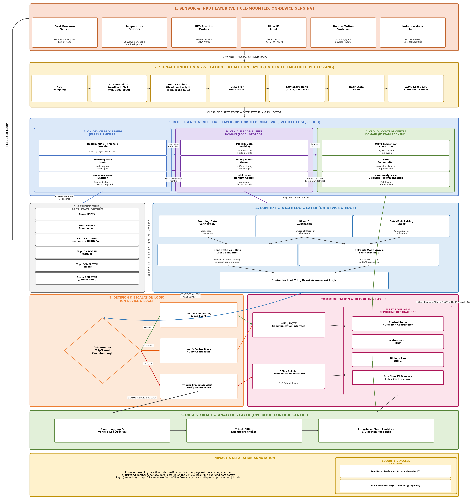

# Multi-tier edge-cloud sensor network for public and institutional bus fleets

Code, prototype and simulation behind the paper "A Multi-Tier Edge-Cloud Sensor Network for Real-Time Seat Availability, Occupancy Verification, Dynamic Fare Computation and Risk Escalation in Public and Institutional Bus Fleets" (Gurirath Singh Khurana, Vellore Institute of Technology).

The system started as the VIT campus shuttle prototype and was generalised to public buses. A force-sensing resistor (FSR) and a DS18B20 probe under each seat, plus one DS18B20 measuring cabin air, feed an ESP32 that filters the pressure signal (median, exponential moving average, hysteresis) and classifies each seat as EMPTY, OBJECT or OCCUPIED from the seat-to-cabin temperature difference. The bus sends a seat summary every 10 s over MQTT (GSM SMS when 4G or Wi-Fi drops), and a control centre combines it with recent segment travel times to show the next buses, their arrival times and their free seats on a television screen at every stop. The same network checks boarding against tickets, computes fares (slab, stage, per-km or flat) and escalates anomalies in three tiers (T1 to T3).

All results in the paper come from software: unit tests, a Wokwi prototype, a physical sensor model and a SUMO corridor simulation. No bus hardware was used. `hardware_tests/` holds the bench and ride protocol for measuring the sensor channel on real seats.



## What is in this repository

| Folder | Contents | Paper sections |
|---|---|---|
| `firmware/` | ESP32 sketch (`vit_shuttle_sketch.ino`) with the 10 Hz pressure filter and the seat/cabin differential thermal classifier, Wokwi circuit (`diagram.json`, seat probe and cabin probe on GPIO18), library list | 3.2 to 3.6, 3.15.1, 4.1 |
| `backend/` | FastAPI + SQLite back end with the MQTT subscriber (Domain C of the prototype) | 3.6.3, 3.12, 3.18 |
| `src/` | React + TypeScript operator dashboard (7 pages) | 3.12, 3.18 |
| `python-gui/` | Tkinter test program and `shuttle_core.py` used for the functional tests and timing benchmarks | 4.5, 4.6, 4.8 |
| `reference/` | `transit_core.py`, the reference module: pressure filter, differential thermal classifier (with blind band and fallback band), NMEA parsing, gate logic, identity profiles, fare engine, ETA, stop boards, T1 to T3 escalation; 60 unit tests | 3.15, 4.3, 4.9 |
| `simulation/` | SUMO corridor simulation (12 km, 20 stops) with the logit rider-choice model, analysis, sensor and vibration model, benchmarks, city-scale load test, coefficient grid, sensitivity variants and statistics | 3.20, 4.2, 4.10, 4.11, 6.2, 6.3 |
| `simulation/results/` | `metrics.json`, `stats.json`, `sensor_filter.json`, `bench.json`, `loadtest.json` and per-run summaries that every number in Sections 4 and 6 comes from | 4, 6 |
| `hardware_tests/` | Bench and ride protocol (`PROTOCOL.md`), ESP32 logging sketch, laptop logger, and `analyze_bench.py` for the calibration, creep, posture, thermal and ride logs | 4.2 |
| `figures/` | Every figure in the paper | Figs. 1 to 20 |
| `docs/` | Architecture diagrams and dashboard screenshots | |

## Figures in the paper

| Fig. | File | Made by |
|---|---|---|
| 1 | `fig_orig_architecture.png` | Architecture diagram (edited) |
| 2 | `fig_orig_pipeline.png` | Processing pipeline diagram (edited) |
| 3 | `fig_display.png` | `simulation/display_fig.py` |
| 4 | `fig_datapath.png` | `simulation/fig_datapath.py` |
| 5, 6 | `fig_sensor_model.png`, `fig_filter_trace.png` | `simulation/sensor_filter_study.py` |
| 7 | `fig_regions.png` | `simulation/figs_core.py` |
| 8 | `fig_response_times.png` | `simulation/figs_core.py` |
| 9, 10, 11 | `fig_storage.png`, `fig_functional.png`, `fig_fare_perkm.png` | `simulation/figs_legacy.py` |
| 12 to 18 | `fig_fares.png`, `fig_load_profile.png`, `fig_seat_error.png`, `fig_eta_error.png`, `fig_staleness.png`, `fig_temperature.png`, `fig_outcomes.png` | `simulation/analyze.py` |
| 19 | `fig_sensitivity.png` | `simulation/figs_sens.py` |
| 20 | `fig_beta_grid.png` | `simulation/figs_grid.py` |

## Reproducing the results

Tested with Python 3.13, SUMO 1.28, Node.js 18+.

```bash
pip install -r requirements.txt
```

Unit tests for the reference module (60 tests, under a second):

```bash
cd reference
python -m pytest -q
```

Statistics and figures from the stored run summaries (no SUMO needed):

```bash
cd simulation
python stats.py
python figs_sens.py
python figs_grid.py
python sensor_filter_study.py
```

Full corridor simulation. `runall.sh` builds the scenario files for seeds 1 to 5 and then runs 120 jobs (5 seeds x 3 scenarios, the 5 x 5 coefficient grid and six variants, three seeds each) on two workers; each run takes about 90 s.

```bash
cd simulation
WORKERS=2 ./runall.sh
python analyze.py    # metrics.json and Figs. 12 to 18
python make_summaries.py   # results/run_summaries.json from the raw runs
python stats.py      # paired t-tests, Table 27, grid
python figs_sens.py && python figs_grid.py
python display_fig.py
python bench.py      # per-call timings
python loadtest.py   # control-centre cycle for a 7,582-bus fleet
```

Scenarios: `A` has no display, `B_real` shows a board built from simulated sensors and links, `B_oracle` shows a board built from true seat counts. Rider choice, demand and network settings can be changed through the environment variables `BETA_0`, `BETA_WAIT`, `BETA_SEAT`, `BETA_CROWD`, `BETA_WAITED`, `KAPPA_EXPOSURE`, `SHELTER_SHARE`, `SEEK_PROB`, `DEMAND_SCALE` and `OUTAGE_EVERY_S`.

## Running the prototype

Firmware: open [wokwi.com](https://wokwi.com), create an ESP32 project, paste `firmware/vit_shuttle_sketch.ino` and `firmware/diagram.json`, and add the libraries in `firmware/libraries.txt`. The sketch publishes to `broker.hivemq.com:1883` under `vit/shuttle1/#`. The seat probe is device index 0 and the cabin probe index 1 on the OneWire bus.

Back end:

```bash
cd backend
python -m venv venv
source venv/bin/activate        # Windows: venv\Scripts\activate
pip install -r requirements.txt
python seed.py
uvicorn main:app --reload --port 8000
```

API docs are at `http://localhost:8000/docs`.

Dashboard:

```bash
npm install
npm run dev
```

Test program:

```bash
cd python-gui
python vit_smart_shuttle_gui.py
```

## Key parameters

| Parameter | Value |
|---|---|
| Pressure channel | 10 Hz, median of 5, EMA α = 0.25, enter 1,200 / exit 1,000 counts, slow baseline tracker |
| Thermal rule | ΔT = T_seat − T_cabin, ε = 1.5 °C, skin contact 35.0 + 0.15 × (T_cabin − 35.0) ± 2.0 °C, 300 s decay check |
| Blind band | cabin about 32 to 38 °C; seats flagged BLIND |
| Fallback | fixed 34 to 42 °C band if the cabin probe fails |
| Rider choice | binary logit, β_wait = −0.35 per min, β_seat = 2.0, β_crowd = 1.0, β_waited = −0.2 per min, κ = 0.5 (sensitivity baseline) |
| Seat summary | every 10 s and on door close, about 200 bytes over MQTT; SMS every 30 s on GSM fallback |
| Stop board | next 4 buses, rebuilt every 10 s, rows older than 60 s marked approximate |
| Institutional fare | max(₹2, distance_km × ₹5) |

## Changes in version 1.1 (journal revision)

1. Pressure channel sampled at 10 Hz and filtered (median of 5, EMA α = 0.25, hysteresis 1,200 / 1,000 counts, slow baseline tracker) in the firmware and the reference module.
2. Second DS18B20 in the cabin air; seats are classified from ΔT = T_seat − T_cabin with a skin-contact check and a 300 s decay check. Seats in the blind band (cabin about 32 to 38 °C) are flagged BLIND. The fixed 34 to 42 °C band is kept only as the fallback when the cabin probe fails, in the firmware, the back end (`/sensor` endpoint takes an optional `cabin_temperature`) and the dashboard text.
3. Rider choice in the simulation is a binary logit model, used as a sensitivity baseline, with a 5 × 5 coefficient grid and six variants.
4. New physical sensor and road-vibration model (`simulation/sensor_filter_study.py`, Figs. 5 and 6) and the bench and ride test kit in `hardware_tests/`.
5. Architecture, pipeline and data-path diagrams updated for the filter and the cabin probe; all simulation figures regenerated.

## Citation

If you use this code, please cite the paper (see `CITATION.cff`).

## Author

Gurirath Singh Khurana, Department of Computer Science and Engineering (AI/ML), School of Computer Science Engineering and Information Systems, Vellore Institute of Technology, Vellore, India.

## License

MIT, see `LICENSE`.
