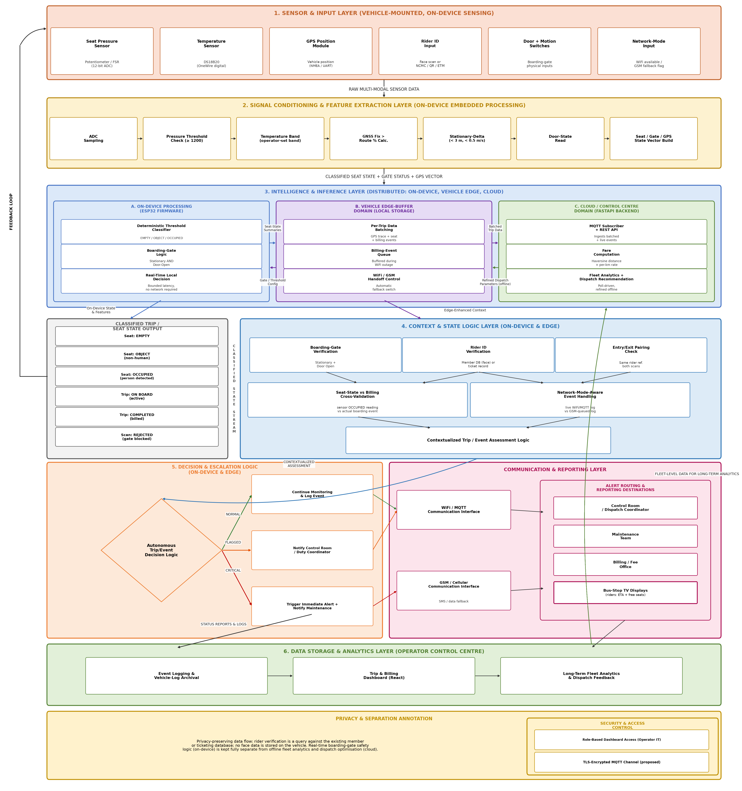

# Multi-tier edge-cloud sensor network for public and institutional bus fleets

Code, prototype and simulation behind the paper "A Multi-Tier Edge-Cloud Sensor Network for Real-Time Seat Availability, Occupancy Verification, Dynamic Fare Computation and Risk Escalation in Public and Institutional Bus Fleets" (Gurirath Singh Khurana, Vellore Institute of Technology).

The system started as the VIT campus shuttle prototype and was generalised to public buses. A force-sensing resistor and a DS18B20 probe under each seat feed an ESP32 that classifies the seat as EMPTY, OBJECT or OCCUPIED. The bus sends a seat summary every 10 s over MQTT (GSM SMS when 4G or Wi-Fi drops), and a control centre combines it with recent segment travel times to show the next buses, their arrival times and their free seats on a television screen at every stop. The same network checks boarding against tickets, computes fares (slab, stage, per-km or flat) and escalates anomalies in three tiers (T1 to T3).



## What is in this repository

| Folder | Contents | Paper sections |
|---|---|---|
| `firmware/` | ESP32 sketch for Wokwi (`vit_shuttle_sketch.ino`), circuit (`diagram.json`), library list | 3.2 to 3.6, 4.1 |
| `backend/` | FastAPI + SQLite back end with the MQTT subscriber (Domain C of the prototype) | 3.6.3, 3.12, 3.18 |
| `src/` | React + TypeScript operator dashboard (7 pages) | 3.12, 3.18 |
| `python-gui/` | Tkinter test program and `shuttle_core.py` used for the functional tests and timing benchmarks | 4.4, 4.5, 4.7 |
| `reference/` | `transit_core.py`, the reference module for the generalised design (classifier with environment setting, NMEA parsing, gate logic, identity profiles, fare engine, ETA, stop boards, T1 to T3 escalation), and 44 unit tests | 3.15, 4.2, 4.8 |
| `simulation/` | SUMO corridor simulation (12 km, 20 stops), analysis, benchmarks, city-scale load test, sensitivity runs and statistics | 3.20, 4.9, 4.10, 6.2, 6.3 |
| `simulation/results/` | `metrics.json`, `bench.json`, `loadtest.json`, `stats.json` and per-run summaries that every number in Sections 4 and 6 comes from | 4, 6 |
| `figures/` | Every figure in the paper | Figs. 1 to 17 |
| `docs/` | Architecture diagrams and dashboard screenshots | |

## Figures in the paper

| Fig. | File | Made by |
|---|---|---|
| 1 | `fig_orig_architecture.png` | Architecture diagram (edited) |
| 2 | `fig_orig_pipeline.png` | Processing pipeline diagram (edited) |
| 3 | `fig_display.png` | `simulation/display_fig.py` |
| 4 | `fig_datapath.png` | `simulation/fig_datapath.py` |
| 5 | `fig_regions.png` | `simulation/figs_core.py` |
| 6 | `fig_response_times.png` | `simulation/figs_core.py` |
| 7 | `fig_storage.png` | `simulation/figs_legacy.py` |
| 8 | `fig_functional.png` | `simulation/figs_legacy.py` |
| 9 | `fig_fare_perkm.png` | `simulation/figs_legacy.py` |
| 10 to 16 | `fig_fares.png`, `fig_load_profile.png`, `fig_seat_error.png`, `fig_eta_error.png`, `fig_staleness.png`, `fig_temperature.png`, `fig_outcomes.png` | `simulation/analyze.py` |
| 17 | `fig_sensitivity.png` | `simulation/figs_sens.py` |

## Reproducing the results

Tested with Python 3.13, SUMO 1.28, Node.js 18+.

```bash
pip install -r requirements.txt
```

Unit tests for the reference module (44 tests, under a second):

```bash
cd reference
python -m pytest -q
```

Statistics and Fig. 17 straight from the stored run summaries (no SUMO needed):

```bash
cd simulation
python stats.py
python figs_sens.py
```

Full corridor simulation (5 seeds x 3 scenarios, about 75 s per run; route files are generated on the first run):

```bash
cd simulation
./runall.sh          # writes results/result_<scenario>_<seed>.json
python analyze.py    # metrics.json and Figs. 10 to 16
python display_fig.py
./runsens.sh         # six sensitivity variants, seeds 1 to 3
python stats.py      # Table 22 and the paired t-tests in Section 6.3
python bench.py      # per-call timings
python loadtest.py   # control-centre cycle for a 7,582-bus fleet
```

Scenarios: `A` has no display, `B_real` shows a board built from simulated sensors and links, `B_oracle` shows a board built from true seat counts. Behaviour, demand and network settings can be changed through `SEEK_PROB`, `WTW_RANGE_S`, `DEMAND_SCALE` and `OUTAGE_EVERY_S` environment variables.

## Running the prototype

Firmware: open [wokwi.com](https://wokwi.com), create an ESP32 project, paste `firmware/vit_shuttle_sketch.ino` and `firmware/diagram.json`, and add the libraries in `firmware/libraries.txt`. The sketch publishes to `broker.hivemq.com:1883` under `vit/shuttle1/#`.

Back end:

```bash
cd backend
python -m venv venv
source venv/bin/activate        # Windows: venv\Scripts\activate
pip install -r requirements.txt
python seed.py
uvicorn main:app --reload --port 8000
```

API docs are at `http://localhost:8000/docs`.

Dashboard:

```bash
npm install
npm run dev
```

Test program:

```bash
cd python-gui
python vit_smart_shuttle_gui.py
```

## Key parameters

| Parameter | Value |
|---|---|
| Pressure threshold | 1,200 ADC counts (12-bit), 3-sample debounce |
| Default temperature band | 34 to 42 °C |
| Environment setting | lower limit = cabin temperature + 2 °C; pressure-only mode above 33 °C |
| Seat summary | every 10 s and on door close, about 200 bytes over MQTT; SMS every 30 s on GSM fallback |
| Stop board | next 4 buses, rebuilt every 10 s, rows older than 60 s marked approximate |
| Institutional fare | max(₹2, distance_km × ₹5) |

## Citation

If you use this code, please cite the paper (see `CITATION.cff`).

## Author

Gurirath Singh Khurana, Department of Computer Science and Engineering (AI/ML), School of Computer Science Engineering and Information Systems, Vellore Institute of Technology, Vellore, India.

## License

MIT, see `LICENSE`.
